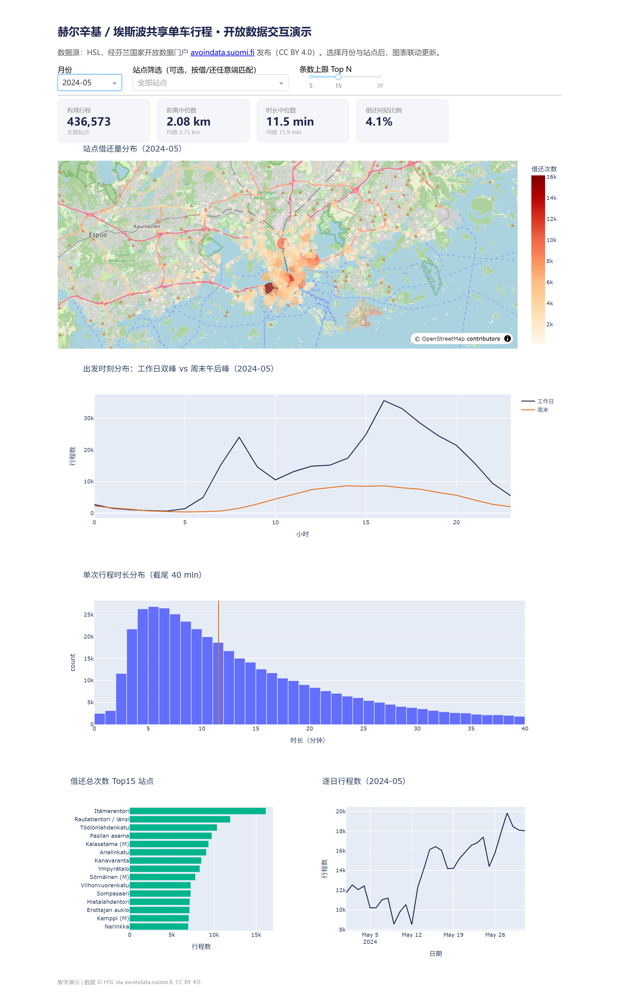

# avoindata-hsl-bikes-demo

用芬兰国家开放数据门户 [avoindata.suomi.fi](https://avoindata.suomi.fi) 上的真实数据做的一个小型教学演示项目：从开放数据门户找数据集 → 下载 CSV → 清洗 → 描述统计 → 可视化。

## 数据

- 数据集：**Helsingin ja Espoon kaupunkipyörillä ajetut matkat**（赫尔辛基与埃斯波共享单车行程 OD 数据）
- 发布机构：Helsingin seudun liikenne（HSL，赫尔辛基大区交通管理局）
- 数据集页：[avoindata.suomi.fi 上的数据集页](https://avoindata.suomi.fi/data/en_GB/dataset/helsingin-ja-espoon-kaupunkipyorilla-ajatut-matkat)
- 许可：**CC BY 4.0**，使用时注明 "Source: HSL, via avoindata.suomi.fi" 即可
- 演示文件：`od-trips-2024-06.csv`，2024 年 6 月全月 46.9 万条原始行程记录（41 MB），字段为出发/到达时间、起止站点编号与名称、距离（米）、时长（秒）
- 月文件 URL 模板：`https://dev.hsl.fi/citybikes/od-trips-{年}/{年}-{月}.csv`，每年 5–10 月（骑行季）发布

## 快速开始

```bash
pip install -r requirements.txt

# 交互式看板（推荐演示用）
python app.py            # 浏览器打开 http://127.0.0.1:8050

# 或命令行静态分析（出四张 PNG）
python scripts/analyze_bike_trips.py            # 自动下载 2024-06 数据并出图
python scripts/analyze_bike_trips.py 2024-07    # 换月份
```

## 交互式看板



功能：月份切换（自动下载该月 CSV）、站点筛选（借/还任意端匹配）、Top N 滑杆；四张 KPI 卡 + 五张联动图表——站点借还量 OpenStreetMap 气泡图、工作日/周末出发时刻曲线、时长直方图、Top N 站点条形图、逐日行程曲线。依赖 `dash` + `plotly`。

## 2024 年 6 月实测结果摘要
- 清洗后 455,496 条有效行程（剔除 13,636 条异常：非正距离/时长、超 30 km、超 3 小时疑似忘还车，以及时间格式不完整的记录）
- 单次距离中位数 2.14 km、均值 2.78 km；时长中位数 11.8 min、均值 16.3 min——典型的右偏分布，中位数比均值更能代表"一次典型骑行"
- 借还同站仅占 4.3%，说明共享单车主要用于"点对点通勤"，而非休闲绕圈
- 工作日呈清晰双峰：早高峰 8 点、晚高峰 16–17 点，峰值约 3.2 万次/小时；周末只有午后一个缓峰
- 最忙站点是 Itämerentori（1.78 万次），最忙 OD 对是 Arielinkatu → Sompasaari（1,288 次，卫星城方向通勤）
- 逐日曲线可见两个低谷（6/9、6/21–23，后者是仲夏节假期），可以用来引导学生把数据曲线和真实世界事件对上

## 课堂用法建议

- **统计与大数据分析**：描述统计（中位数 vs 均值的选择）、分组聚合（`groupby`）、分布形状判断、异常值处理四件事一份数据全包。
- **大数据与人工智能**：演示"直接下载文件"与"CKAN Action API 找数据集"两种获取方式（API 端点是 `https://avoindata.suomi.fi/data/fi/api/3/action/`），讲数据目录与元数据。
- **数据新闻 / 融合新闻产品策划与制作**：让学生挑一个月，找出一个"反常点"（如低谷日），写 200 字数据解释并配图——练数据故事。
- **作业改造方向**：换成 7 月或 8 月数据对比；限定埃斯波站点做城市间对比；把 Top10 OD 对画到地图上（站点表里有经纬度，可另行下载）。

## 目录

```text
├── data/                 # 原始 CSV（首次运行自动下载，.gitignore 排除）
├── outputs/              # 生成的图表与看板截图
├── app.py                # Dash 交互式看板
├── scripts/
│   └── analyze_bike_trips.py   # 命令行静态分析
└── requirements.txt
```

## 注意

- 数据字段名是英文，站点名是芬兰语，正适合讲"非中文/非英文数据也要能上手"。
- 原始 CSV 带 UTF-8 BOM，pandas 直接 `read_csv` 即可；个别行时间格式不完整（只有日期），脚本用 `ISO8601` 宽容解析后剔除——这是真实开放数据的典型脏点，课堂上值得展开讲。
- HSL 同时提供站点经纬度数据集（`Helsingin Seudun Liikenteen (HSL) kaupunkipyöräasemat`），想加地图可视化时按需下载。
